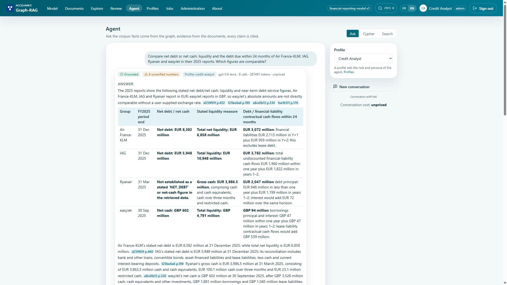
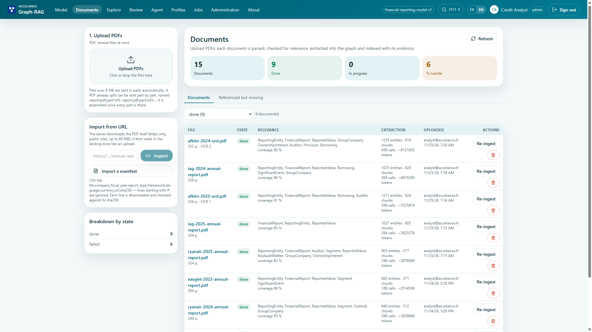
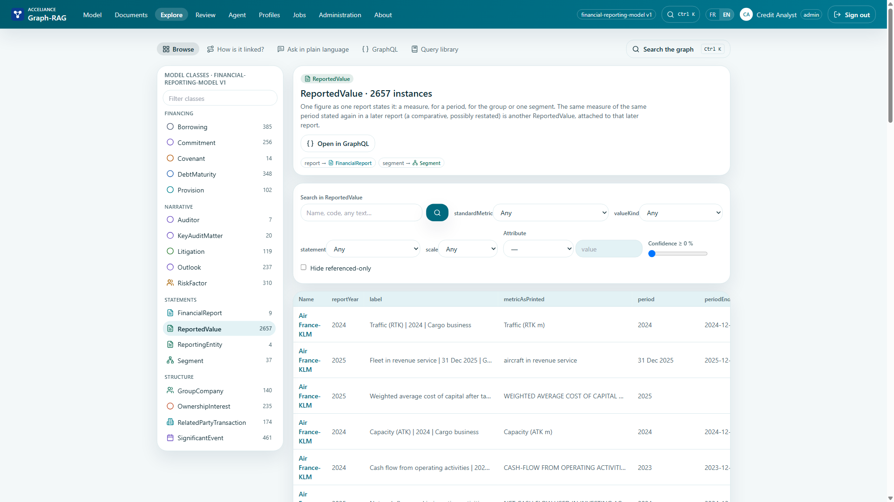
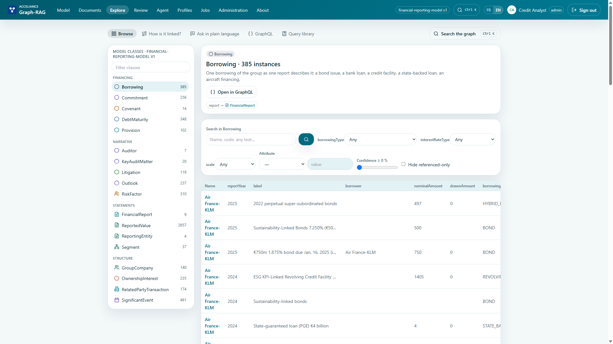
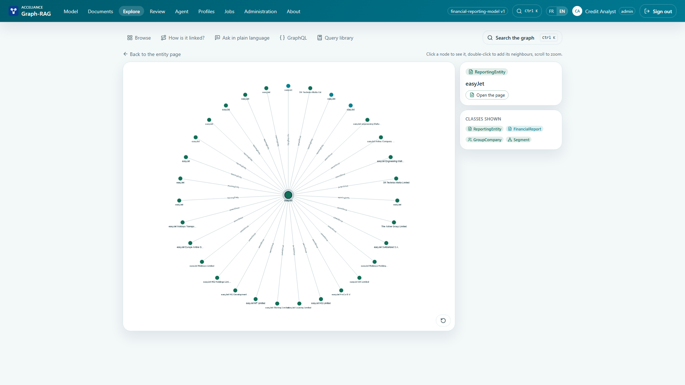
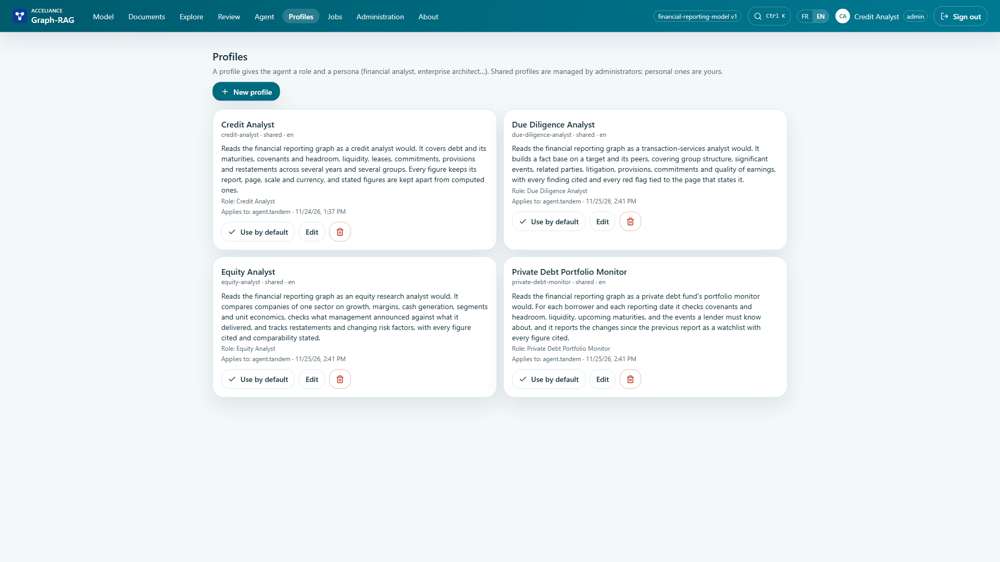
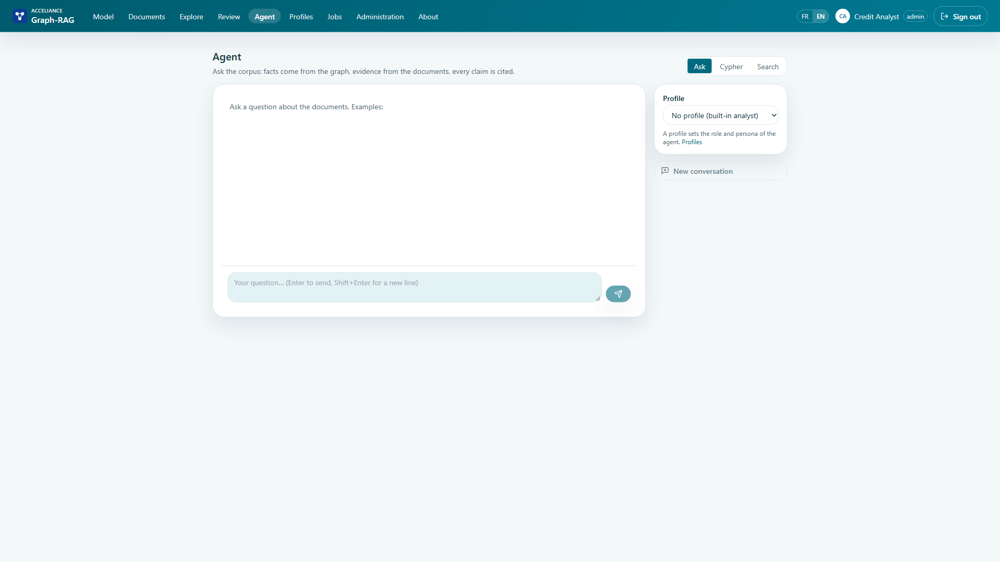
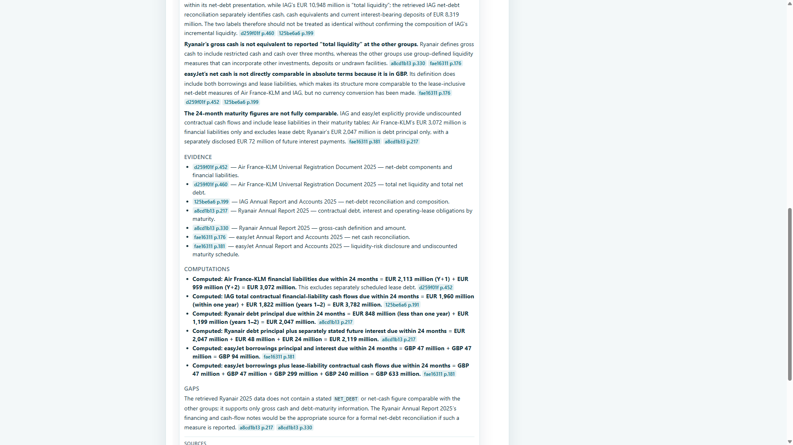
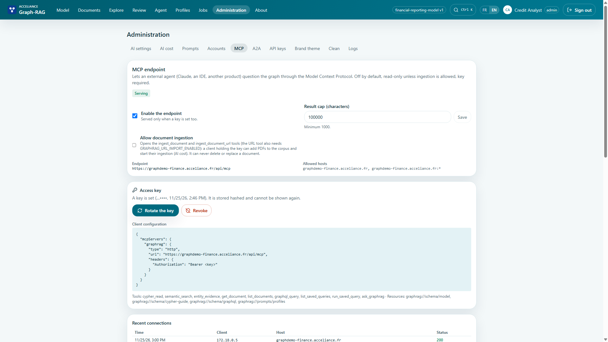

# Ask your annual reports. Every figure cited.

[](https://github.com/acceliance)
[](LICENSE)
[](https://hub.docker.com/repositories/acceliance)
[](https://youtu.be/fq_D_m8yj9M)

> **An instance of Graph-Rag-Deploy.** This project is [Graph-Rag-Deploy](https://github.com/acceliance/Graph-Rag-Deploy), the Acceliance Graph-RAG deployment kit, set up for one domain, financial reporting: the same product images, with a data model, analyst profiles and a list of public annual reports of its own. For everything that is not specific to this domain, Graph-Rag-Deploy is the reference.

- **Credit analysts:** still copying covenants and debt maturities out of 400-page annual reports?
- **Due diligence teams:** a data room of thousands of pages, and ten days to find what matters?
- **Private debt funds:** twenty portfolio companies, every quarter: who checks each covenant against each report?
- **Equity analysts:** five competitors, three years, fifteen reports: which figures were restated?

**What if you could just ask them?**

[Acceliance Graph-RAG](https://github.com/acceliance/Graph-Rag-Deploy) reads annual reports and turns them into a knowledge graph you can question. Each answer gives the figure as printed, the report and the page that states it, so you can check it in seconds. This repository holds what a finance team needs to run it on its own machines: the data model, four analyst profiles, and a script that downloads public annual reports.

[](https://youtu.be/fq_D_m8yj9M)

*One question, four annual reports. The agent answers as a credit analyst, cites each page, and says what it could not establish. Click the image to watch the video (2 min 34).*

This is a tool to support analysis. It is not investment advice and it gives no rating. Open the cited page before you rely on a figure.

## A report a team would take days to write

We loaded the annual reports of four European airline groups and asked an AI agent (Claude, over MCP) for a credit comparison and a lender watchlist. It read the graph and wrote [this report](docs/sample-report-european-airlines-2025.md) from four 2025 annual reports, 1,400 pages in all. We then checked every figure against its page.

Amounts in millions, as printed, in each group's reporting currency:

| | Air France-KLM | IAG | Ryanair | easyJet |
|---|---|---|---|---|
| Net debt, or net cash | Net debt EUR 8,392 (p.452) | Net debt EUR 5,948 (p.41) | Net cash EUR 1,304 (p.4) | Net cash GBP 602 (p.176) |
| Net debt / EBITDA, as stated | 1.66x (p.374) | 0.8x (p.41) | Not applicable | Not applicable |
| Debt due within 24 months | 3,072 (p.450) | 3,782 (p.191) | 2,120.0 (p.295) | 94 (p.181) |
| Computed: share of stated liquidity | 33% | 35% | 53% | 2% |
| Covenants | Tested, stated as met (p.451) | No financial covenants (p.160) | None described | None described |
| Watchlist status | Watch | No adverse change | No adverse change | No adverse change |

The report also covers aircraft orders, key audit matters, what is comparable between the four groups and what is not, and the gaps in the data.

## What you can ask

- How did net debt and covenant headroom change between two financial years?
- Which debt matures within 24 months, and at what rate?
- Which figures of last year were restated in this year's report, and why?
- Which segments lost margin, and what reason does management give?
- Which risks appear this year that were absent last year?
- How do five companies of one sector compare on the same measure, each with its source page?

## How it works

### 1. Load the reports

Drop the PDFs on the **Documents** screen. Each report is parsed, checked and extracted into the graph, and each step is traced page by page. The demo holds 9 annual reports of 4 airline groups, 2,930 pages.



### 2. Browse the facts, company by company

The [financial reporting model](model/README.md) declares what a report contains: 18 classes for figures, borrowings, covenants, debt maturities, risks, provisions, events and group structure. From the 9 reports, the graph holds 2,657 reported figures, 385 borrowings and 310 risk factors. Each report keeps its own figures, so a later year never overwrites an earlier one.



*Each figure keeps the caption as printed, its period, its scale and its currency.*



*Bonds, loans and credit facilities of four groups, side by side.*



*Navigate from a group to its reports, subsidiaries and segments.*

### 3. Give the agent a role

A profile sets who answers: the role, the rules and the layout of the answer. Four profiles come with this repository, in [`samples/profiles/`](samples/README.md#agent-profiles):

| Profile | Reader | What it produces |
|---|---|---|
| [Credit analyst](samples/profiles/credit-analyst.md) | Credit analysts | Debt, maturities, covenant headroom, liquidity, commitments |
| [Due diligence analyst](samples/profiles/due-diligence-analyst.md) | Transaction services and M&A teams | Numbered findings, red flags with the document that would close each, requests |
| [Private debt monitor](samples/profiles/private-debt-monitor.md) | Private debt funds | A portfolio table, changes since the previous report, a watchlist |
| [Equity analyst](samples/profiles/equity-analyst.md) | Equity research | Peer comparison tables, growth and margins, guidance against delivery |

All four follow the same rules: cite every figure with its report and page, keep stated figures apart from computed ones, and give no advice.





### 4. Ask, and check

The agent reads the graph and the pages behind it. It keeps stated figures and its own computations apart, and it says what is comparable, what is not, and what the graph does not hold.



### 5. Connect your own tools

The graph is also served over MCP, read-only and protected by a key, so Claude, Copilot or your own agents can query it. That is how the [airline report](docs/sample-report-european-airlines-2025.md) above was written. Your profiles are also published as Agent2Agent skills, and every AI call is journaled with its cost.



## What it took: pages, time and cost

These are the figures of the demo graph, measured on 24 and 25 November 2026 on one Ubuntu server.

| AI role | Model |
|---|---|
| Extraction | Anthropic `claude-sonnet-5-5` |
| Agent answers | OpenAI `gpt-5.6-terra` |
| Embeddings | OpenAI `text-embedding-3-large`, 1,024 dimensions |

| Report | Pages | Processing time | Input tokens | Output tokens | Extraction cost | Entities in the graph |
|---|---|---|---|---|---|---|
| easyJet 2023 | 204 | 28 min | 2.30 M | 225 k | $6.85 | 471 |
| easyJet 2024 | 212 | 26 min | 2.29 M | 216 k | $6.74 | 446 |
| easyJet 2025 | 196 | 30 min | 2.49 M | 237 k | $7.34 | 441 |
| Ryanair 2024 | 244 | 44 min | 3.58 M | 331 k | $10.47 | 633 |
| Ryanair 2025 | 334 | 45 min | 3.93 M | 318 k | $11.03 | 599 |
| IAG 2024 | 338 | 28 min | 2.28 M | 166 k | $6.21 | 721 |
| IAG 2025 | 334 | 23 min | 2.50 M | 142 k | $6.43 | 706 |
| Air France-KLM 2025 | 536 | 43 min | 3.41 M | 201 k | $8.82 | 832 |
| **Total of these 8 reports** | **2,398** | **4 h 27 min** | **22.8 M** | **1.84 M** | **$63.89** | **4,849** |

So a report costs about $8 to extract and takes about half an hour, or about $2.70 and 11 minutes per 100 pages.

How to read these figures:

- **Cost** is tokens multiplied by the rates Anthropic billed for the extraction model: $2 per million input tokens and $10 per million output tokens. Embeddings are not included.
- **Processing time** is the time of the run that completed, from parsing to verification.
- **Air France-KLM 2024** (532 pages, 841 entities) is in the graph but not in the table: its first run stopped and was resumed from its checkpoints, and a run that stops is not journaled, so its cost is not known.
- **Six more reports** of the manifest (Lufthansa 2023 to 2025, and the 2023 reports of Ryanair, IAG and Air France-KLM) are not in the graph yet.
- An agent answer that compares four companies used about 290,000 tokens.

## What is in this repository

| Folder | Content |
|---|---|
| [`model/`](model/README.md) | The financial reporting data model, [`financial-reporting-model.json`](model/financial-reporting-model.json): 18 classes and 18 enumerations in four domains (statements, financing, narrative, structure) |
| [`samples/`](samples/README.md) | The four [agent profiles](samples/README.md#agent-profiles) |
| [`samples/real-reports/`](samples/real-reports/README.md) | The manifest of 15 public annual reports, downloaded onto your machine by [`scripts/fetch-reports.ps1`](scripts/fetch-reports.ps1) or [`scripts/fetch-reports.sh`](scripts/fetch-reports.sh) |
| [`docs/`](docs/) | The [sample airline report](docs/sample-report-european-airlines-2025.md) and the [AI model recommendations](docs/ai-model-recommendations.md) |
| [`schemas/`](schemas/README.md) | JSON Schemas for the model, the ingestion ledger and the prompt files |
| [`modelio/`](modelio/) | The GraphRag module for Modelio that declares the Graph-RAG stereotypes |
| [`DEPLOY.md`](DEPLOY.md) | The deployment guide: sizing, HTTPS, AI provider settings, backup, upgrade, troubleshooting |

## Quick start

You need Docker Desktop (Windows, macOS) or Docker Engine 24+ with Compose v2, and an AI provider key for the chat, extraction and embedding roles. You enter the key in the application, never in a file.

```powershell
.\scripts\up.ps1
```

```bash
scripts/up.sh
```

The script creates `.env` with generated secrets, pulls the images, starts the stack and prints the URL, `http://localhost:8080` by default. Then:

1. Create the administrator account.
2. Enter your AI provider settings under **Admin ▸ AI settings**.
3. Upload [`model/financial-reporting-model.json`](model/financial-reporting-model.json) on the **Model** screen.
4. Add the profiles of [`samples/profiles/`](samples/profiles/) on the **Profiles** screen.
5. Upload reports on the **Documents** screen, then ask on the **Agent** screen.

The [user manual](https://github.com/acceliance/Graph-Rag-Deploy/blob/main/USER-MANUAL.md) walks through every screen. To deploy on a server with HTTPS, see [`DEPLOY.md`](DEPLOY.md).

## Real annual reports

Annual reports are public, but they belong to their issuers, so this repository holds none. It holds a list of addresses, [`samples/real-reports/manifest.csv`](samples/real-reports/manifest.csv), and a script that downloads each report from its publisher's own site onto your machine and checks it against its SHA-256 checksum:

```powershell
.\scripts\fetch-reports.ps1
```

```bash
scripts/fetch-reports.sh
```

The files land in `samples/real-reports/downloads/`, which is never committed. [`samples/real-reports/README.md`](samples/real-reports/README.md) explains how to add a report to the list and what to watch for when several companies share one graph.

Without a licence file, ingestion stops at 50 documents. The licence is free: request it by e-mail at contact@acceliance.fr, see *Licensing* in [`DEPLOY.md`](DEPLOY.md).

## Confidential documents

Chunks and extracted values are sent to the AI providers you configure. For documents that are not public, configure an on-premises provider for the three roles: nothing then leaves your network.

## Licence

The files of this repository (Compose file, scripts, schemas, model, documentation) are under the [Apache License 2.0](LICENSE). The product images are free of use under their own licence, described in [`LICENSE-IMAGES.md`](LICENSE-IMAGES.md). The reports the script downloads are not part of this repository and keep their publishers' terms.
