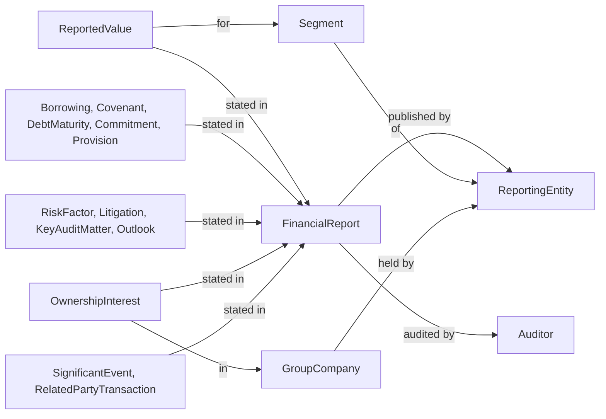

# The financial reporting model

[`financial-reporting-model.json`](financial-reporting-model.json) describes what Graph-RAG extracts from an annual report: 18 classes, 18 enumerations and 46 relations in four domains. [`financial-reporting-model.mmd`](financial-reporting-model.mmd) is its class diagram (Mermaid).

**State: first draft.** The file passes the product's model validation with no error and no warning. It has not been run on a report yet, so the extraction hints and the key described below are untested.

## The design rule: stable things and as-reported facts

A report restates the past. The revenue of 2024 is printed in the 2024 report and again, as a comparative, in the 2025 report, sometimes with another amount. In the product, when two documents disagree on an attribute of one node, the last document written wins. So the model separates two kinds of classes.

| Kind | Classes | Identity | Across reports |
|---|---|---|---|
| Stable things | `ReportingEntity`, `GroupCompany`, `Auditor`, `Segment` | Their name (`Segment`: issuer and name) | One node, shared by every report that names it |
| As-reported facts | `FinancialReport` and the thirteen classes attached to it | `issuer` + `reportYear` + `label` (`FinancialReport`: `issuer` + `reportYear`) | One node per report: nothing is overwritten |

Every as-reported fact therefore carries the name of the group and the year of the report it comes from, and a `report` relation to its `FinancialReport`. Two reports of one group never share a figure, and neither do two groups.

Consequences to know:

- **A restatement is found by a query, not by a relation.** The 2024 revenue stated in the 2024 report and the one stated in the 2025 report are two `ReportedValue` nodes with the same `standardMetric`, the same period and the same issuer. Comparing their amounts shows the restatement; `isRestated` and the `SignificantEvent` of type `RESTATEMENT` give the reason.
- **Comparing groups goes through `standardMetric`.** Each `ReportedValue` keeps the caption as printed and maps it to a common list (`REVENUE`, `NET_DEBT`, `OPERATING_CASH_FLOW`…). The list includes airline indicators (passengers, capacity, load factor, unit cost) for the sample corpus; extend it for another sector.
- **Amounts are stored as printed**, with their `scale` (units, thousands, millions, billions) and `currency`. Nothing is multiplied or converted at extraction; the agent profile must do it, and say so, when it compares.
- **The key depends on a steady spelling.** `issuer` must be written the same way on every fact of every report of a group (Lufthansa Group, not Deutsche Lufthansa AG). The hints ask for the short commercial name of the cover. This is the first thing to check on real reports: a fact whose issuer is spelled differently is not attached to its report.

## Classes

| Domain (extraction group) | Class | What it holds |
|---|---|---|
| Statements | `ReportingEntity` | The group that publishes |
| | `FinancialReport` | One PDF: period, framework, audit opinion |
| | `Segment` | A business segment or geographical area |
| | `ReportedValue` | One figure, for a period, for the group or a segment |
| Financing | `Borrowing` | A bond, loan or facility: amount, rate, maturity, security |
| | `Covenant` | Required level, level reached, status |
| | `DebtMaturity` | One cell of the maturity schedule |
| | `Commitment` | Firm orders, guarantees, pledges, other off-balance-sheet items |
| | `Provision` | A provision and its movement over the year |
| Narrative | `RiskFactor` | A risk, its mitigation, its trend |
| | `Litigation` | A proceeding: amounts claimed and provided, status |
| | `Auditor` | The audit firm |
| | `KeyAuditMatter` | A key audit matter and the audit response |
| | `Outlook` | Guidance and medium-term targets |
| Structure | `GroupCompany` | A subsidiary, joint venture or associate |
| | `OwnershipInterest` | Percentage held and consolidation method, per report |
| | `RelatedPartyTransaction` | A transaction or balance with a related party |
| | `SignificantEvent` | Acquisition, disposal, restatement, refinancing, subsequent event |

The relevance gate uses three anchors: `FinancialReport`, `ReportingEntity` and `ReportedValue`.

Each domain is one extraction group, so every page is read four times, once per group. The product shows the estimated cost of a document before it is ingested.

## Trying it

1. Upload [`financial-reporting-model.json`](financial-reporting-model.json) on the **Model** screen, *Validate*, then *Initialise*.
2. Ingest one report first, a short one (`easyjet-2025-annual-report.pdf`, 196 pages), then the report of the previous year of the same group.
3. Check on **Documents** and **About** that the facts are attached to their report, that the two reports did not overwrite each other's figures, and what the **Review** screen proposes for `GroupCompany`.

## Modelio

The Modelio project is meant to be the reference for a model (see [`../DEPLOY.md`](../DEPLOY.md), *Designing the model in Modelio*). This draft was written directly as JSON. To continue in Modelio, create a project with the ModelioUtils and GraphRag modules and use **Import Model** on this file.
